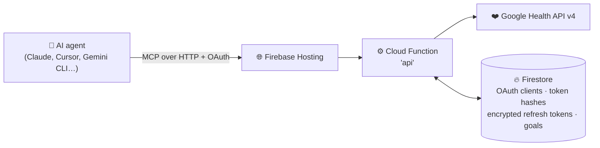
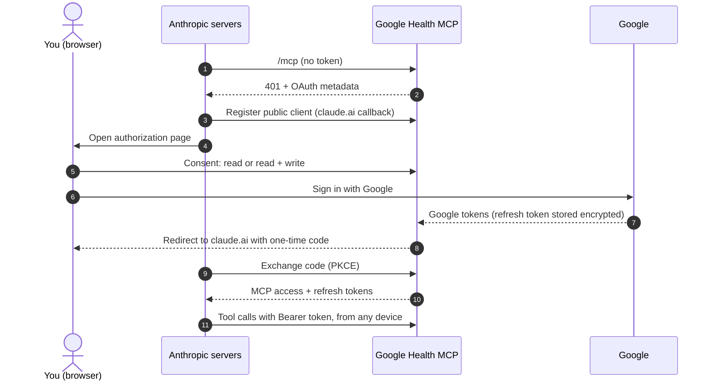

<p align="center">
  
</p>

<h1 align="center">Google Health MCP</h1>

A remote [Model Context Protocol](https://modelcontextprotocol.io) server that lets your AI agent (Claude,
Claude Code, OpenCode, Gemini CLI, Cursor, VS Code…) read and log your health and fitness data through the
[Google Health API](https://developers.google.com/health). It includes data synced into Google Health from
Apple Health and Health Connect, and adds coaching goals that the API itself doesn't provide.

- **Multi-user and reusable:** you deploy your own instance to Firebase. Each person signs in with their own
  Google account through OAuth, and nothing user-specific is hard-coded.
- **Secure by design:** OAuth 2.1 with Google sign-in. Agents never see Google tokens, and no health data is
  stored or logged (see [Security notes](#security-notes)).
- **Built for coaching:** daily summaries, goal tracking with a smoothed weight trend and energy balance,
  workout, sleep and nutrition analysis, plus tools to log meals, water, weight and workouts.

## How it works



### 🔐 Sign-in

The function is an OAuth authorization server for MCP clients (discovery, dynamic client registration, PKCE).
When an agent connects, the user approves it on a consent page and signs in with Google. The function keeps
the Google refresh token and gives the agent its own short-lived tokens. See the
[Claude sign-in flow](#connect-your-agent) for a step-by-step diagram.

### ⚙️ Under the hood

- **Stateless:** each `/mcp` request gets a fresh MCP server instance, so any function instance can serve it.
- **Deduplicated:** reads use Google Health's reconciled stream across all sources
  (see [Apple Health data](#apple-health-data)).
- **API limits handled for you:**

| Limit                                                                                                                                                                 | How the server handles it                             |
| --------------------------------------------------------------------------------------------------------------------------------------------------------------------- | ----------------------------------------------------- |
| Aggregates are capped at **14 days** per request for heart rate, total calories, active minutes and calories in heart-rate zones, and **90 days** for everything else | Longer ranges are split automatically                 |
| Workouts and sleep come back **25 per page**                                                                                                                          | The server follows the pages                          |
| **300 requests per minute** per user                                                                                                                                  | Rate-limit and server errors are retried with backoff |

### 🔑 Scopes

| Access                                                               | When requested                          |
| -------------------------------------------------------------------- | --------------------------------------- |
| Read: activity, health metrics, sleep, nutrition, profile, settings  | Always                                  |
| Write                                                                | Only if the user picks _Read and write_ |
| ECG, irregular rhythm notifications, GPS routes, reproductive health | Never                                   |

## What the agent can do

| Tool                                                                        | Purpose                                                                                                                                                               |
| --------------------------------------------------------------------------- | --------------------------------------------------------------------------------------------------------------------------------------------------------------------- |
| `get_user_context`                                                          | Timezone, today's date, preferred units, profile, devices, granted permissions, goals. Agents call this first.                                                        |
| `get_daily_summaries`                                                       | One row per day (≤ 90 days): steps, distance, calories burned, Active Zone Minutes, resting HR, HRV, sleep, weight, body fat, calories/macros eaten, water, workouts. |
| `get_metric_series`                                                         | Any metric per day/week, or intraday (hour … 1 min) buckets.                                                                                                          |
| `list_data_points`                                                          | Raw or reconciled entries of any data type, with their source (e.g. `HEALTH_KIT · Apple Watch`).                                                                      |
| `get_workouts`, `get_sleep_sessions`, `get_nutrition_logs`                  | Summarized sessions and food diary.                                                                                                                                   |
| `check_data_sources`                                                        | Which platforms (Fitbit, Pixel, Apple Health, Health Connect…) contributed recent data.                                                                               |
| `get_goals`, `set_goals`, `get_goal_progress`                               | Coaching goals and progress: calorie/macro/water targets, weight target and date, steps, AZM, workouts, sleep, and a free-text coaching plan.                         |
| `log_meal`, `log_water`, `log_body_measurement`, `log_workout`, `log_sleep` | Write to Google Health (only if the user granted write access).                                                                                                       |
| `delete_entries`                                                            | Delete entries this server created.                                                                                                                                   |
| `update_settings`                                                           | Unit preferences and stride lengths.                                                                                                                                  |

Prompts: `weekly_review`, `fat_loss_plan`, `log_food`.

## Limitations

- **Goals are stored by this server, not in Google Health.** The Google Health API v4 has no goals endpoint
  (the old Fitbit Web API did). Goals live in Firestore, work with every agent, and are evaluated against live
  data, but the Google Health app doesn't show them.
- **Unverified apps get weekly re-authentication.** All Google Health scopes are _restricted_. While your OAuth
  app is in _Testing_ status, it is limited to 100 test users that you add by hand, and Google refresh tokens
  expire after 7 days. When that happens, the agent gets an authentication error and you reconnect. Lifting
  these limits requires [app verification](https://developers.google.com/health/app-verification), which
  includes a security assessment.
- **Blaze plan required.** Cloud Functions and Secret Manager need a pay-as-you-go Firebase project. Personal
  use normally stays within the free tiers.

## Setup

You need:

- A Google account that has completed onboarding in the Google Health app (otherwise the API returns `412`).
- Node.js 22+ and the [Firebase CLI](https://firebase.google.com/docs/cli) (`npm i -g firebase-tools`).
- Optionally, the `gcloud` CLI for the command-line steps. Each step also works in the console.

In the steps below, replace `PROJECT_ID` with your Firebase project ID.

### 1. Create the Firebase project

1. Create a project in the [Firebase console](https://console.firebase.google.com/), or reuse an existing one,
   and upgrade it to the **Blaze** plan.
2. Create a **Firestore** database in Native mode (Firebase console → Build → Firestore Database → Create
   database). Any location works.

### 2. Enable the APIs

Enable the **Google Health API** on its
[API library page](https://console.developers.google.com/apis/library/health.googleapis.com) with your
project selected. The Firebase CLI enables the rest during deploy, or you can enable everything at once:

```sh
gcloud services enable health.googleapis.com cloudfunctions.googleapis.com cloudbuild.googleapis.com \
  artifactregistry.googleapis.com run.googleapis.com eventarc.googleapis.com secretmanager.googleapis.com \
  firestore.googleapis.com --project PROJECT_ID
```

### 3. Configure the OAuth consent screen (Google Auth Platform)

In the Google Cloud console for the same project, open **Google Auth Platform**:

1. **Branding:** set an app name (e.g. "My Health MCP") and a support email.
2. **Audience** ([link](https://console.developers.google.com/auth/audience)): set user type **External** and
   leave publishing status on **Testing**. Under **Test users**, add the Google account of every person who
   will connect, including yourself.
3. **Data Access** ([link](https://console.developers.google.com/auth/scopes)): click _Add or remove scopes_
   and add:
   - `openid` and `.../auth/userinfo.email`
   - Google Health API, read: `googlehealth.activity_and_fitness.readonly`,
     `googlehealth.health_metrics_and_measurements.readonly`, `googlehealth.sleep.readonly`,
     `googlehealth.nutrition.readonly`, `googlehealth.profile.readonly`, `googlehealth.settings.readonly`
   - Google Health API, write (needed only if users will pick "Read and write"):
     `googlehealth.activity_and_fitness.writeonly`, `googlehealth.health_metrics_and_measurements.writeonly`,
     `googlehealth.sleep.writeonly`, `googlehealth.nutrition.writeonly`, `googlehealth.profile.writeonly`,
     `googlehealth.settings.writeonly`

### 4. Create the OAuth client

On the [Credentials](https://console.developers.google.com/apis/credentials) page, choose **Create
credentials → OAuth client ID → Web application** and add these **Authorized redirect URIs**:

```
https://PROJECT_ID.web.app/oauth/google/callback
http://localhost:8080/oauth/google/callback      # optional, for npm run dev
http://localhost:5002/oauth/google/callback      # optional, for the Hosting emulator
```

Copy the **client ID** and **client secret**. If you serve the app from a custom domain, add
`https://your.domain/oauth/google/callback` as well and set `PUBLIC_BASE_URL` in the next step.

### 5. Configure and deploy

```sh
git clone https://github.com/limbowalker/google-health-mcp.git && cd google-health-mcp
firebase use --add PROJECT_ID
(cd functions && npm install)

# Non-secret parameters (see functions/.env.example)
cat > functions/.env.PROJECT_ID <<'EOF'
GOOGLE_CLIENT_ID=1234567890-abc.apps.googleusercontent.com
PUBLIC_BASE_URL=auto
ALLOWED_EMAILS=*
MIN_INSTANCES=0
EOF

# Secrets (stored in Secret Manager)
firebase functions:secrets:set GOOGLE_CLIENT_SECRET          # paste the client secret
openssl rand -base64 32 | firebase functions:secrets:set TOKEN_ENCRYPTION_KEY --data-file=-

# First deploy only: auto-delete old function container images (otherwise a
# non-interactive deploy stops after the function and never releases Hosting)
firebase functions:artifacts:setpolicy --location us-central1 --force

firebase deploy --only functions,hosting,firestore
```

| Parameter                         | Meaning                                                                                                                                                                                                              |
| --------------------------------- | -------------------------------------------------------------------------------------------------------------------------------------------------------------------------------------------------------------------- |
| `GOOGLE_CLIENT_ID`                | OAuth client ID from step 4.                                                                                                                                                                                         |
| `PUBLIC_BASE_URL`                 | Public origin. `auto` means `https://PROJECT_ID.web.app`.                                                                                                                                                            |
| `ALLOWED_EMAILS`                  | `*`, or a comma-separated list of accounts and `@domains` allowed to connect. This applies on top of the test-user list.                                                                                             |
| `GOOGLE_CLIENT_SECRET` _(secret)_ | OAuth client secret.                                                                                                                                                                                                 |
| `TOKEN_ENCRYPTION_KEY` _(secret)_ | 32-byte key that encrypts Google refresh tokens. If you rotate it, users have to reconnect.                                                                                                                          |
| `MIN_INSTANCES`                   | Optional, default `0`. Set to `1` to keep an instance warm. Claude allows its OAuth discovery, registration and token requests 10 seconds, and a cold start uses part of that. A warm instance is billed while idle. |

Open `https://PROJECT_ID.web.app/`; the page shows the MCP URL, `https://PROJECT_ID.web.app/mcp`.

**Optional:** let Firestore delete expired OAuth records automatically:

```sh
for c in authRequests authCodes tokens; do
  gcloud firestore fields ttls update ttl --collection-group=$c --enable-ttl --project PROJECT_ID
done
```

## Connect your agent

Every client below discovers the OAuth endpoints automatically and opens a browser to sign in. On the consent
page, choose _Read only_ or _Read and write_, then approve the scopes on Google's screen.

**Claude Code**

```sh
claude mcp add --transport http google-health https://PROJECT_ID.web.app/mcp
```

Then run `/mcp` in Claude Code, select `google-health`, and authenticate.

**Claude (claude.ai, Claude Desktop, Claude for iOS and Android):** on claude.ai or in Claude Desktop, open
[Customize → Connectors](https://claude.ai/customize/connectors), click **+** → _Add custom connector_, paste
`https://PROJECT_ID.web.app/mcp`, and click _Add_. Leave _Advanced settings_ empty: Claude registers itself
with this server automatically. Then click _Connect_ to sign in. Connectors belong to your Claude account, so
the connection then works in the mobile apps too. Enable it per chat under **+** → _Connectors_. On Team and
Enterprise plans, an Owner adds the connector under Organization settings → Connectors, and each member
then clicks _Connect_.

How sign-in works for the hosted Claude apps (web, Desktop, iOS, Android, Cowork):



- Anthropic's servers (`160.79.104.0/21`) make every call, not your device. Claude registers with redirect URI
  `https://claude.ai/api/mcp/auth_callback`.
- Neither Claude nor your device ever receives Google credentials or Google tokens.
- When the Google grant lapses (every 7 days in Testing mode), refresh fails with `invalid_grant` and Claude
  asks you to connect again.

**Gemini CLI**: add to `~/.gemini/settings.json`, then run `/mcp auth google-health`:

```json
{
  "mcpServers": {
    "google-health": { "httpUrl": "https://PROJECT_ID.web.app/mcp" }
  }
}
```

**OpenCode**: add to `opencode.json`, then run `opencode mcp auth google-health`:

```json
{
  "$schema": "https://opencode.ai/config.json",
  "mcp": {
    "google-health": {
      "type": "remote",
      "url": "https://PROJECT_ID.web.app/mcp"
    }
  }
}
```

**Cursor** (`~/.cursor/mcp.json`) and **VS Code** (`.vscode/mcp.json`):

```json
{
  "mcpServers": { "google-health": { "url": "https://PROJECT_ID.web.app/mcp" } }
}
```

```json
{
  "servers": {
    "google-health": { "type": "http", "url": "https://PROJECT_ID.web.app/mcp" }
  }
}
```

**Agents without OAuth support:** open `https://PROJECT_ID.web.app/connect`, sign in, and copy the personal
token (valid for 90 days). Send it as an `Authorization: Bearer ghm_…` header from any client that supports
custom headers.

Then try: _"Use google-health to review my last week"_, or use the `weekly_review` prompt.

## Apple Health data

The Google Health API records where each data point came from: `HEALTH_KIT` for Apple Health,
`HEALTH_CONNECT` for Android apps. All tools query the reconciled `all-sources` stream by default, which
removes overlapping entries from multiple devices and includes this data in summaries. Raw mode
(`list_data_points`, `get_workouts mode=raw`, `get_nutrition_logs`) shows every entry's source.

Apple Health data only arrives through Google Health's own sync, which you control in the Google Health app on
your iPhone, and only data types the Google Health API models are available. To check that sync works, ask the
agent to run `check_data_sources`.

## Local development

```sh
cd functions
cp .env.example .env.local        # set GOOGLE_CLIENT_ID; PUBLIC_BASE_URL=auto means http://localhost:8080
printf 'GOOGLE_CLIENT_SECRET=...\nTOKEN_ENCRYPTION_KEY=%s\n' "$(openssl rand -base64 32)" > .secret.local
npm run dev                       # http://localhost:8080/mcp, in-memory store
npm test                          # unit + end-to-end tests with a stubbed Google API
npm run serve                     # Firebase emulators: Hosting :5002 → function → Firestore
```

For the emulators, set `PUBLIC_BASE_URL=http://localhost:5002` in `.env.local`. The emulator reads the same
`.env.local` and `.secret.local` files.

## Security notes

- A consent page is shown for every authorization, naming the requesting client and its redirect host. A
  browser-binding cookie (`__session`) ties the consent and the Google callback to the browser that started
  the flow.
- Access tokens (1 h), refresh tokens (30 days, rotated on every use) and personal tokens (90 days) are random
  opaque values. Only their SHA-256 hashes are stored.
- Google refresh tokens are encrypted with AES-256-GCM. If Google rejects one (because it was revoked or
  expired), all of that user's MCP tokens are revoked so the agent re-authenticates.
- Firestore security rules deny all client access. Only the function reads or writes, through the Admin SDK.
- Users can revoke access at any time in their Google Account permissions, or in the Google Health app under
  _Apps and services_.

## Troubleshooting

| Symptom                                                                    | Fix                                                                                                         |
| -------------------------------------------------------------------------- | ----------------------------------------------------------------------------------------------------------- |
| "Access blocked" / "app has not completed verification" on Google's screen | Add the account as a test user (step 3.2).                                                                  |
| Tools say the Google authorization expired                                 | Expected every 7 days in Testing mode. Reconnect the server in your agent.                                  |
| "Google Health profile isn't ready" (HTTP 412)                             | Open the Google Health app and finish onboarding.                                                           |
| A tool says a permission wasn't granted                                    | Reconnect and allow that category on Google's consent screen, or choose _Read and write_ for logging tools. |
| "Browser mismatch"                                                         | Finish the sign-in in the browser where it started.                                                         |
| Rate-limit errors                                                          | The API allows 300 requests per minute per user. Wait a minute or query smaller ranges.                     |

## Project layout

```
firebase.json, firestore.rules      Hosting rewrite → Cloud Function "api"; deny-all Firestore rules
functions/src/index.ts              Firebase entry point (params, secrets)
functions/src/app.ts                Express app: OAuth endpoints + stateless Streamable HTTP /mcp
functions/src/auth/                 OAuth provider, Google federation, consent pages, crypto
functions/src/health/               Google Health REST client, data type catalog, time + summary helpers
functions/src/mcp/                  MCP server, tools, prompts, goals math
functions/src/store/                Firestore and in-memory storage
functions/test/                     Vitest unit and end-to-end tests
```

## License

[GNU AGPL-3.0](LICENSE). You can use, modify and self-host this server freely. If you distribute it, or run a
modified version as a network service, you must keep the copyright and attribution notices and publish your
source code under the same license.
